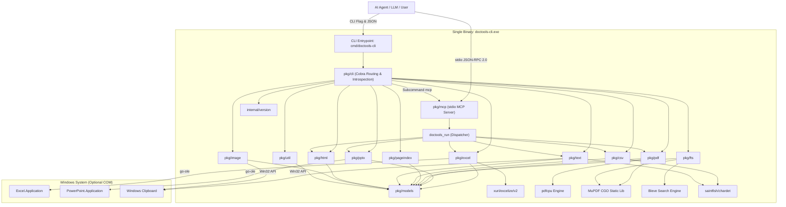
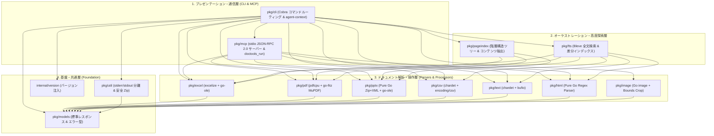
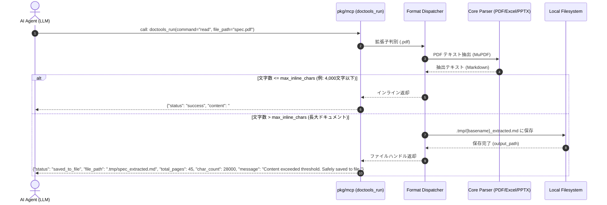
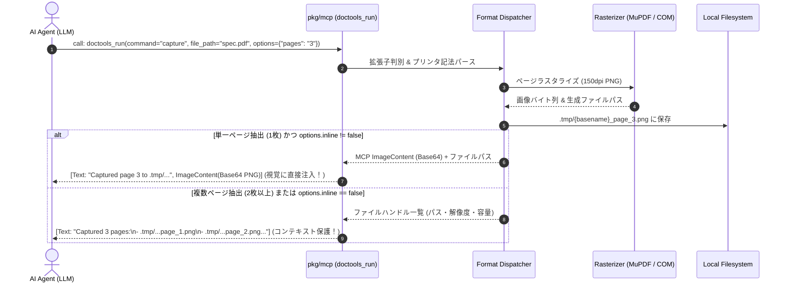
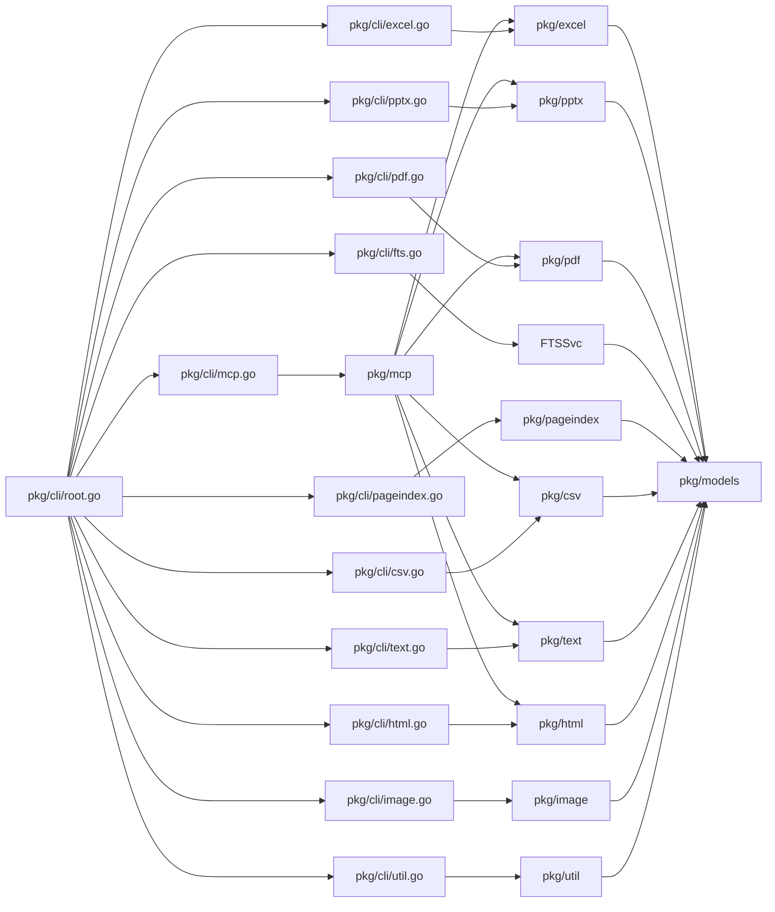

# Agent-Native CLI 設計書 (`doctools-cli`)

## 目次
- [機能一覧](#機能一覧)
- [機能詳細](#機能詳細)
- [アーキテクチャ](#アーキテクチャ)
    - [設計方針](#設計方針)
    - [全体構成図](#全体構成図)
    - [レイヤー構造](#レイヤー構造)
    - [全体シーケンス図](#全体シーケンス図)
    - [データフロー図](#データフロー図)
- [インターフェース](#インターフェース)
    - [CLI インターフェース (主要コマンド IPO)](#cli-インターフェース-主要コマンド-ipo)
    - [MCP インターフェース (`doctools_run`)](#mcp-インターフェース-doctools_run)
        - [Tool 定義 (JSON Schema)](#tool-定義-json-schema)
        - [Smart Dynamic Response 処理シーケンス](#smart-dynamic-response-処理シーケンス)
- [コンポーネント](#コンポーネント)
    - [ハイレベル・コンポーネント図](#ハイレベルコンポーネント図)
    - [コンポーネント・パッケージ詳細 IPO テーブル](#コンポーネントパッケージ詳細-ipo-テーブル)
- [データモデル](#データモデル)
    - [Bleve FTS インデックス構造](#bleve-fts-インデックス構造)
    - [PageIndex JSON スキーマ](#pageindex-json-スキーマ)
    - [Excel パッチ JSON スキーマ & Go 構造体](#excel-パッチ-json-スキーマ--go-構造体-pkgexcel)
- [エラーハンドリング](#エラーハンドリング)

---

## 機能一覧

| 機能カテゴリ | 機能ID | 機能名 | 概要 | 対応要件ID |
|:---|:---|:---|:---|:---|
| 横断・基盤 | CLI-F01 | non-interactive | 対話プロンプト完全排除・`--force` による安全上書き制御 | NFR-01 |
| 横断・基盤 | CLI-F02 | structured-output | `--json` による構造化出力および `stderr` エラーハンドリング | NFR-02 |
| 探訪 | INTRO-F01 | agent-context | CLI の全サブコマンドと引数型定義を JSON 出力 | NFR-03 |
| 品質・検証 | QA-F01 | test-coverage | 主要パッケージにおけるカバレッジ 90% 以上の達成 | NFR-04 |
| Excel操作 | EXCEL-F01 | excel list-sheets | Excel 内の全シート名一覧を取得 | EXCEL-01 |
| Excel操作 | EXCEL-F02 | excel extract-csv | Excel シートを個別の CSV ファイルとして抽出 | EXCEL-02 |
| Excel操作 | EXCEL-F03 | excel extract-images | Excel シートを Fit-to-Page 設定で PDF 化 (`go-ole`) | EXCEL-03 |
| Excel操作 | EXCEL-F05 | excel diff | Excel ファイル間のセル単位差分比較 (値, 数式, 結合範囲 `merged_range`) | EXCEL-05 |
| Excel操作 | EXCEL-F06 | excel patch | 自動バックアップ・BOMトリム・配列パッチ・`old_value`ガードレール付き安全パッチ適用 | EXCEL-06 |
| Excel操作 | EXCEL-F07 | excel extract-markdown | Excel シートの Markdown 抽出 (オプション `--with-coords` でセル座標付与) | EXCEL-07 |
| Excel操作 | EXCEL-F08 | excel search-cell | キーワードによるセル検索およびセル番地・結合情報取得 | EXCEL-08 |
| Excel操作 | EXCEL-F09 | excel extract-text | excel extract-markdown への統一エイリアス | EXCEL-09 |
| PowerPoint操作 | PPTX-F01 | pptx extract-text | PPTX スライドのテキストを Markdown として抽出 | PPTX-01 |
| PowerPoint操作 | PPTX-F02 | pptx merge | 複数の PPTX ファイルを 1 つにマージ | PPTX-02 |
| PowerPoint操作 | PPTX-F03 | pptx extract-images | PPTX スライドを指定解像度で PNG 化 (`go-ole`) | PPTX-03 |
| PDF操作 | PDF-F01 | pdf extract-text | PDF テキストを高精度に Markdown として抽出 (`go-fitz` / MuPDF CGO) | PDF-01 |
| PDF操作 | PDF-F02 | pdf split / pdf merge | PDF の特定ページ切り出し、および複数 PDF 結合 | PDF-02 |
| PDF操作 | PDF-F03 | pdf extract-images | PDF 埋め込み画像オブジェクトの抽出 (`pdfcpu`) | PDF-03 |
| PDF操作 | PDF-F04 | pdf extract-pages | PDF ページ全画面ラスタライズ画像化 (`go-fitz` / MuPDF CGO) | PDF-04 |
| 全文検索 (FTS) | FTS-F01 | fts build | Bleve エンジンによる並列 N-gram 全文検索インデックス構築 | FTS-01 |
| 全文検索 (FTS) | FTS-F02 | fts query | キーワードおよびブール条件による全文検索 (AI ナビゲーション付与) | FTS-02 |
| 全文検索 (FTS) | FTS-F03 | fts build --file-timeout | タイムアウト制御による安全なファイルスキップ | FTS-03 |
| 全文検索 (FTS) | FTS-F04 | fts build --include-ext | 対象拡張子の包含・除外フィルター | FTS-04 |
| 全文検索 (FTS) | FTS-F05 | fts query (Self-Describing) | AI エージェント向けクエリ構文・フィールド定義の自己説明 | FTS-05 |
| 全文検索 (FTS) | FTS-F06 | fts build (--include-dir / --exclude-dir) | 隠しディレクトリのデフォルト除外 & ディレクトリ包含/除外フィルター | FTS-06 |
| 構造RAG | PAGEINDEX-F01 | pageindex tree / content | 決定論的構造 PageIndex ツリー探索およびピンポイント抽出 (ADR-0010) | PAGEINDEX-01 |
| 構造RAG | PAGEINDEX-F02 | pageindex tree | 目次・ツリー構造の段階的取得 | PAGEINDEX-02 |
| 構造RAG | PAGEINDEX-F03 | pageindex content | 特定ノード / ページ / シートのフルテキストピンポイント抽出 | PAGEINDEX-03 |
| CSV操作 | CSV-F01 | csv read-cells | 指定した行・列範囲のセル値を JSON 配列取得 | CSV-01 |
| CSV操作 | CSV-F02 | csv search | CSV 内の文字列検索とセル位置取得 | CSV-02 |
| CSV操作 | CSV-F03 | csv metadata | CSV のエンコーディング・行数・列数取得 | CSV-03 |
| CSV操作 | CSV-F04 | csv extract | CSV の指定範囲を別 CSV へ切り出し抽出 | CSV-04 |
| テキスト操作 | TEXT-F01 | text head / text tail | テキストファイルの先頭 / 末尾行取得 | TEXT-01 |
| テキスト操作 | TEXT-F02 | text grep | 正規表現によるテキストファイル内検索 | TEXT-02 |
| テキスト操作 | TEXT-F03 | text metadata / text convert | 文字コード判定および相互変換 | TEXT-03 |
| テキスト操作 | TEXT-F04 | text copy-clipboard | クリップボードへのテキスト設定 (Windows) | TEXT-04 |
| HTML操作 | HTML-F01 | html extract-text | HTML ファイルから Markdown テキスト抽出 | HTML-01 |
| 画像操作 | IMAGE-F01 | image metadata | 画像の解像度（幅・高さ）等のメタデータ取得 | IMAGE-01 |
| 画像操作 | IMAGE-F02 | image crop | 画像の指定領域切り抜き (Crop) | IMAGE-02 |
| 画像操作 | IMAGE-F03 | image save-clipboard | クリップボード画像の PNG 保存 (Windows) | IMAGE-03 |
| 共通ユーティリティ | UTIL-F01 | util zip / util unzip | 複数ファイルの ZIP 圧縮、および解凍 | UTIL-01 |
| MCPサーバー | MCP-F01 | mcp server | stdio JSON-RPC 2.0 による MCP サーバー起動 | MCP-01 |
| MCPサーバー | MCP-F02 | doctools_run (Dispatcher) | 統合ディスパッチャによる拡張子自動判定と内部エンジン呼び出し | MCP-02 |
| MCPサーバー | MCP-F03 | Smart Dynamic Response | 文字数閾値に応じたインライン直接返却とファイル保存の動的切り替え | MCP-03 |
| MCPサーバー | MCP-F04 | search (single file) | 単一ファイル内を対象としたピンポイントキーワード検索 | MCP-04 |
| MCPサーバー | MCP-F05 | capture (Smart Dynamic Capture) | 単一ページBase64視覚注入と複数ページファイルハンドル返却の動的切り替え | MCP-05 |

※注: 要件定義において `EXCEL-04` は欠番となっており、`EXCEL-03` の次は `EXCEL-05` となっています。

---

## 機能詳細

### 機能カテゴリ: 横断・基盤・品質
- **CLI-F01: non-interactive**
  - **概要**: TTY有無にかかわらず対話プロンプトを一切表示せず、安全な非対話実行を行う。上書き時は `--force` を要求。
  - **対応要件**: NFR-01
- **CLI-F02: structured-output**
  - **概要**: `--json` フラグにより機械判読可能な JSON を `stdout` に出力し、エラー時は `stderr` に出力して非ゼロ終了コードを返す。
  - **対応要件**: NFR-02
- **INTRO-F01: agent-context**
  - **概要**: CLI コマンドの全構文、引数型、オプション定義を JSON 形式で自己説明出力する。
  - **対応要件**: NFR-03
- **QA-F01: test-coverage**
  - **概要**: 主要ロジックパッケージにおけるステートメントカバレッジ 90% 以上を維持する。
  - **対応要件**: NFR-04

### 機能カテゴリ: Excel操作 (EXCEL)
- **EXCEL-F01: excel list-sheets / EXCEL-F02: excel extract-csv / EXCEL-F03: excel extract-images**
  - **概要**: Excel シート一覧取得・CSV 個別抽出・Fit-to-Page 設定による PDF 出力 (`go-ole`)。
  - **対応要件**: EXCEL-01, EXCEL-02, EXCEL-03
- **EXCEL-F05: excel diff**
  - **概要**: 2つの XLSX ファイル間でセル単位の差分（値、数式、結合範囲）を抽出。
  - **対応要件**: EXCEL-05
- **EXCEL-F06: excel patch**
  - **概要**: 安全ガードレール付きパッチ適用（`old_value` 検証、BOM 除去、自動バックアップ、`--schema` 出力）。
  - **対応要件**: EXCEL-06
- **EXCEL-F07: excel extract-markdown / EXCEL-F08: excel search-cell / EXCEL-F09: excel extract-text**
  - **概要**: セル座標付き Markdown 抽出・セル内キーワード検索・抽出統一エイリアス。
  - **対応要件**: EXCEL-07, EXCEL-08, EXCEL-09

### 機能カテゴリ: PowerPoint操作 (PPTX)
- **PPTX-F01: pptx extract-text / PPTX-F02: pptx merge / PPTX-F03: pptx extract-images**
  - **概要**: 純 Go (Zip+XML) スライドテキスト抽出、XML 構造マージ、`go-ole` スライド画像化。
  - **対応要件**: PPTX-01, PPTX-02, PPTX-03

### 機能カテゴリ: PDF操作 (PDF)
- **PDF-F01: pdf extract-text**
  - **概要**: `MuPDF (go-fitz)` による ToUnicode CMap 解決高精度日本語テキスト抽出（`--start-page`, `--end-page` 対応）。
  - **対応要件**: PDF-01
- **PDF-F02: pdf split / pdf merge**
  - **概要**: `pdfcpu` によるページ切り出しおよび複数 PDF 結合。
  - **対応要件**: PDF-02
- **PDF-F03: pdf extract-images**
  - **概要**: `pdfcpu` による PDF 埋め込み画像オブジェクトの抽出。
  - **対応要件**: PDF-03
- **PDF-F04: pdf extract-pages**
  - **概要**: `MuPDF (go-fitz)` による全画面ラスタライズ画像化。
  - **対応要件**: PDF-04

### 機能カテゴリ: 全文検索 (FTS)
- **FTS-F01: fts build / FTS-F02: fts query / FTS-F03: fts build --file-timeout / FTS-F04: fts build --include-ext / FTS-F05: fts query (Self-Describing) / FTS-F06: fts build (--include-dir / --exclude-dir)**
  - **概要**: Bleve による並列 N-gram 全文検索インデックス構築・差分更新・タイムアウトスキップ・隠しフォルダ除外・AI ナビゲーション付与。
  - **対応要件**: FTS-01, FTS-02, FTS-03, FTS-04, FTS-05, FTS-06

### 機能カテゴリ: 構造RAG (PAGEINDEX)
- **PAGEINDEX-F01: pageindex build / PAGEINDEX-F02: pageindex tree / PAGEINDEX-F03: pageindex content**
  - **概要**: ドキュメント構造ツリー解析・段階的ツリー取得・ピンポイント本文抽出。
  - **対応要件**: PAGEINDEX-01, PAGEINDEX-02, PAGEINDEX-03

### 機能カテゴリ: CSV操作 (CSV)
- **CSV-F01: csv read-cells / CSV-F02: csv search / CSV-F03: csv metadata / CSV-F04: csv extract**
  - **概要**: CSV セル抽出・値検索・自動エンコーディング判定 (`chardet`)・別ファイル保存。
  - **対応要件**: CSV-01, CSV-02, CSV-03, CSV-04

### 機能カテゴリ: テキスト操作 (TEXT)
- **TEXT-F01: text head/tail / TEXT-F02: text grep / TEXT-F03: text metadata/convert / TEXT-F04: text copy-clipboard**
  - **概要**: 先頭・末尾行表示、正規表現 Grep 検索、エンコーディング判定 (`chardet`) 変換、Windows クリップボード設定。
  - **対応要件**: TEXT-01, TEXT-02, TEXT-03, TEXT-04

### 機能カテゴリ: HTML / IMAGE / UTIL
- **HTML-F01: html extract-text / IMAGE-F01: image metadata / IMAGE-F02: image crop / IMAGE-F03: image save-clipboard / UTIL-F01: util zip/unzip**
  - **概要**: HTML テキスト抽出、画像メタデータ・切り抜き・クリップボード保存、ZIP 圧縮・解凍。
  - **対応要件**: HTML-01, IMAGE-01〜03, UTIL-01

### 機能カテゴリ: MCPサーバー (MCP)
- **MCP-F01: mcp server (stdio JSON-RPC 2.0)**
  - **概要**: `doctools-cli mcp` による stdio MCP サーバー起動、エージェント環境（Antigravity, Claude, Cursor 等）の Tool Definition Block への 1 級市民常駐。
  - **対応要件**: MCP-01
- **MCP-F02: doctools_run (Unified Dispatcher)**
  - **概要**: 単一ツールから拡張子を自動判定し、内部パーサー（PDF, XLSX, PPTX, CSV 等）へディスパッチ。
  - **対応要件**: MCP-02
- **MCP-F03: Smart Dynamic Response (動的閾値ハンドリング)**
  - **概要**: 抽出テキストが閾値（デフォルト 4,000 文字）以下は直接 Markdown 返却、超過時は自動でローカルファイル保存とパス返却。
  - **対応要件**: MCP-03
- **MCP-F04: 単一ファイル内ピンポイント検索 (command: search)**
  - **概要**: 対象ファイル内を高速走査し、一致したページ番号・シート名・スライド番号と前後ハイライトスニペットを返却。
  - **対応要件**: MCP-04
- **MCP-F05: Smart Dynamic Capture (command: capture)**
  - **概要**: プリンタ記法で指定したページ群を高解像度画像化。単一ページ時は MCP ImageContent (Base64) をインライン返却して LLM 視覚に注入し、複数ページ時はファイルハンドル（パス一覧）のみ返却してコンテキスト溢れを完全防止。
  - **対応要件**: MCP-05

---

## アーキテクチャ

### 設計方針
1. **Agent-Native Dual Interface**: 非対話型・JSON構造化出力 (`stdout`/`stderr` 完全分離)・3-Layer Introspection に加え、stdio JSON-RPC 2.0 MCP サーバーを内蔵し、エージェントの推論サンプリング空間に 1 級市民として常駐。
2. **統合ディスパッチャ (Unified Dispatcher / Gateway)**: ツール過多（Tool Overload）を防ぐため、MCP ツールを `doctools_run` に集約し、拡張子自動判定とコアアクション (`read`, `search`, `capture`) で整理。
3. **Smart Dynamic Response & Capture**: テキストは文字数閾値、画像は抽出ページ数（単一ページは Base64 注入、複数ページはファイルハンドル）で動的に切り替え、LLM の即応性とコンテキスト保護を両立。
4. **単一実行バイナリ (Single Binary)**: CGO 静的リンクによる MuPDF / Bleve / `go-ole` を単一バイナリ `doctools-cli.exe` に内蔵し、外部ランタイム依存ゼロを実現。
5. **厳格な単方向依存**: コアパーサーおよびモデル層は上位 CLI / MCP 層に依存しない。

### 全体構成図



### レイヤー構造



---

## インターフェース

### CLI インターフェース (主要コマンド IPO)

全サブコマンドは標準で `--json` フラグ（構造化 JSON 出力）および `--force` フラグ（非対話的実行）をサポートします。

1. **`doctools-cli agent-context`**
   - Input: `--json` (bool)
   - Processing: Cobra コマンドツリー走査による JSON スキーマ生成
   - Output: 全コマンド構文・パラメータ定義の JSON
2. **`doctools-cli excel list-sheets <file>`**
   - Input: `file` (string)
   - Processing: `excelize` によるシート名一覧取得
   - Output: `{"sheets": ["Sheet1", "Sheet2"]}`
3. **`doctools-cli excel extract-csv <file>`**
   - Input: `file` (string), `--sheets` (string), `--output-dir` (string)
   - Processing: シート走査および CSV 保存
   - Output: `{"output_paths": [".../Sheet1.csv"]}`
4. **`doctools-cli excel extract-images <file>`**
   - Input: `file` (string), `--output-dir` (string)
   - Processing: `go-ole` 経由で Fit-to-Page 設定を行い PDF エクスポート
   - Output: `{"output_paths": [".../temp_Sheet1.pdf"]}`
5. **`doctools-cli excel diff <file_a> <file_b>`**
   - Input: `file_a` (string), `file_b` (string), `--sheets` (string)
   - Processing: セル単位での値・数式・結合範囲差分抽出
   - Output: `{"total_changes": 2, "differences": [...]}`
6. **`doctools-cli excel patch <file>`**
   - Input: `file` (string), `--patch-file` (string), `--backup` (bool), `--dry-run` (bool), `--schema` (bool)
   - Processing: `old_value` 事前検証、自動バックアップ、結合セル代表代入
   - Output: `{"applied_count": 1, "audit_log": [...]}`
7. **`doctools-cli excel extract-markdown <file>`**
   - Input: `file` (string), `--sheets` (string), `--with-coords` (bool), `--output` (string)
   - Processing: Markdown テーブル形式抽出（セル座標プレフィックス対応）
   - Output: `{"output_path": ".../table.md"}`
8. **`doctools-cli excel search-cell <file> <query>`**
   - Input: `file` (string), `query` (string), `--sheets` (string)
   - Processing: 指定シート内の全セル文字列検索
   - Output: `{"total_matches": 3, "matches": [...]}`
9. **`doctools-cli excel extract-text <file>`**
   - Input: `file` (string), `--sheets` (string), `--with-coords` (bool), `--output` (string)
   - Processing: `excel extract-markdown` の統一エイリアス実行
   - Output: `{"output_path": ".../table.md"}`
10. **`doctools-cli pptx extract-text <file>`**
    - Input: `file` (string), `--output` (string)
    - Processing: Zip+XML スライド解析と Markdown 書き出し
    - Output: `{"output_path": ".../presentation.md"}`
11. **`doctools-cli pptx merge <files...>`**
    - Input: `files` ([]string), `--output` (string)
    - Processing: スライド構造の結合
    - Output: `{"output_path": ".../merged.pptx"}`
12. **`doctools-cli pptx extract-images <file>`**
    - Input: `file` (string), `--slides` (string), `--width` (int), `--height` (int)
    - Processing: `go-ole` 経由で PowerPoint スライド Export
    - Output: `{"output_paths": [".../slide_001.png"]}`
13. **`doctools-cli pdf extract-text <file>`**
    - Input: `file` (string), `--output` (string), `--start-page` (int), `--end-page` (int)
    - Processing: `go-fitz` (MuPDF) による ToUnicode CMap 解決高精度テキスト抽出
    - Output: `{"content": "...", "output_path": ".../document.md"}`
14. **`doctools-cli pdf split <file>`** / **`pdf merge <files...>`**
    - Input: `file` (string), `--start-page` (int), `--end-page` (int) / `files` ([]string), `--output` (string)
    - Processing: `pdfcpu` ページ分離および結合
    - Output: `{"output_path": ".../out.pdf"}`
15. **`doctools-cli pdf extract-images <file>`**
    - Input: `file` (string), `--output-dir` (`-o`) (string), `--pages` (string)
    - Processing: `pdfcpu` による埋め込み画像オブジェクトの抽出
    - Output: `{"output_paths": [".../img_001.png"]}`
16. **`doctools-cli pdf extract-pages <file>`**
    - Input: `file` (string), `--output-dir` (`-o`) (string), `--dpi` (int), `--format` (string), `--start-page` (int), `--end-page` (int)
    - Processing: `go-fitz` (MuPDF) による各ページの全画面ラスタライズ保存
    - Output: `{"total_pages": 3, "dpi": 150, "format": "png", "output_paths": [".../report_page_01.png"]}`
17. **`doctools-cli fts build <dir>`**
    - Input: `dir` (string), `--index-path` (string), `--file-timeout` (duration), `--include-ext` (stringSlice), `--exclude-ext` (stringSlice), `--include-dir` (stringSlice), `--exclude-dir` (stringSlice), `--force` (bool), `--verbose` (bool)
    - Processing: On-the-fly テキスト化・`mtime` 差分比較・タイムアウト制御・Bleve インデックス書き込み
    - Output: `{"indexed_files": 30, "skipped_files": 90, "timeout_files": 0, "indexed_chunks": 120, "time_ms": 450}`
18. **`doctools-cli fts query <index-path> <query>`**
    - Input: `index-path` (string), `query` (string), `--limit` (int)
    - Processing: Bleve ハイライター/フラグメンターによる前後スニペットと AI ナビゲーション付与
    - Output: `{"total_hits": 5, "hits": [{"score": 1.452, "snippet": "...", "source": {...}, "target": {...}}]}`
19. **`doctools-cli pageindex tree <file>`**
    - Input: `file` (string), `--node-id` (string), `--depth` (int)
    - Processing: 目次ツリーの取得・階層切り出し
    - Output: `{"nodes": [...]}`
20. **`doctools-cli pageindex content <file>`**
    - Input: `file` (string), `--node-id` (string)
    - Processing: ノード ID に紐づく本文抽出
    - Output: `{"content": "..."}`
21. **`doctools-cli csv read-cells <file>`**
    - Input: `file` (string), `--start-row` (int), `--end-row` (int), `--columns` ([]int), `--header-row` (int)
    - Processing: `encoding/csv` ストリーム読み込み
    - Output: `{"data": [[...]]}`
22. **`doctools-cli csv search <file> <query>`**
    - Input: `file` (string), `query` (string)
    - Processing: キーワード一致セル検索
    - Output: `{"results": [{"row": 5, "col": 2, "value": "..."}]}`
23. **`doctools-cli csv metadata <file>`**
    - Input: `file` (string)
    - Processing: `chardet` エンコーディング判定と行列数取得
    - Output: `{"encoding": "Shift_JIS", "total_rows": 100, "max_columns": 10}`
24. **`doctools-cli csv extract <file>`**
    - Input: `file` (string), `--output` (string), `--start-row` (int), `--end-row` (int)
    - Processing: 指定領域の別 CSV 保存
    - Output: `{"output_path": ".../subset.csv"}`
25. **`doctools-cli text head <file>`** / **`text tail <file>`**
    - Input: `file` (string), `--lines` (int)
    - Processing: ファイル先頭・末尾行取得
    - Output: `{"lines": ["..."]}`
26. **`doctools-cli text grep <file> <pattern>`**
    - Input: `file` (string), `pattern` (string)
    - Processing: 正規表現一致行の抽出
    - Output: `{"matches": [{"line": 10, "text": "..."}]}`
27. **`doctools-cli text metadata <file>`** / **`text convert <file>`**
    - Input: `file` (string), `--encoding` (string), `--output` (string)
    - Processing: `chardet` 判定および相互変換
    - Output: `{"encoding": "UTF-8", "output_path": "..."}`
28. **`doctools-cli text copy-clipboard <text>`**
    - Input: `text` (string)
    - Processing: Windows API クリップボード書き込み
    - Output: `{"message": "Copied"}`
29. **`doctools-cli html extract-text <file>`**
    - Input: `file` (string), `--output` (string)
    - Processing: HTML パースと Markdown 変換
    - Output: `{"output_path": ".../page.md"}`
30. **`doctools-cli image metadata <file>`**
    - Input: `file` (string)
    - Processing: 画像ヘッダ解析による幅・高さ取得
    - Output: `{"width": 1920, "height": 1080, "format": "png"}`
31. **`doctools-cli image crop <file>`**
    - Input: `file` (string), `--output` (string), `--left` (int), `--top` (int), `--right` (int), `--bottom` (int)
    - Processing: 指定矩形領域の境界検証およびクロップ保存
    - Output: `{"output_path": ".../crop.png"}`
32. **`doctools-cli image save-clipboard`**
    - Input: `--output` (string)
    - Processing: クリップボード画像取得と PNG 保存
    - Output: `{"output_path": ".../clip.png"}`
33. **`doctools-cli util zip <files...>`**
    - Input: `files` ([]string), `--output` (string)
    - Processing: `archive/zip` によるファイル・ディレクトリ圧縮
    - Output: `{"output_path": "..."}`
34. **`doctools-cli util unzip <file>`**
    - Input: `file` (string), `--output-dir` (string)
    - Processing: `archive/zip` による Zip Slip ガード付き安全解凍
    - Output: `{"output_dir": "..."}`
35. **`doctools-cli mcp`**
    - Input: stdio (JSON-RPC 2.0 messages)
    - Processing: stdio 経由での Model Context Protocol サーバー起動およびリクエスト処理
    - Output: stdio (JSON-RPC 2.0 responses)

### MCP インターフェース (`doctools_run`)

エージェント環境（Antigravity, Claude, Cursor 等）向けに、単一の統合ディスパッチャ `doctools_run` を提供します。

#### Tool 定義 (JSON Schema)

```json
{
  "name": "doctools_run",
  "description": "CRITICAL: ALWAYS use this tool instead of read_file or python scripts when inspecting, reading, or searching PDF, Excel (.xlsx), PowerPoint (.pptx), CSV, Text/Markdown, or HTML files. Automatically extracts high-accuracy text/markdown. Small contents are returned directly; large contents are safely saved to a markdown file to protect context.",
  "inputSchema": {
    "type": "object",
    "properties": {
      "command": {
        "type": "string",
        "enum": ["read", "search", "capture"],
        "description": "'read' extracts text/tables from the document; 'search' queries keywords within the specific document; 'capture' renders pages/slides/sheets into images (single page returns inline Vision image, multiple pages return file handles)"
      },
      "file_path": {
        "type": "string",
        "description": "Target document path (e.g., 'docs/spec.pdf', 'data/sheet.xlsx')"
      },
      "query": {
        "type": "string",
        "description": "Search keyword (required when command='search')"
      },
      "options": {
        "type": "object",
        "properties": {
          "pages": { "type": "string", "description": "Page range or selection (e.g. '1', '2-4', '1,3,5') for PDF/PPTX/Excel" },
          "sheet": { "type": "string", "description": "Sheet name for Excel" },
          "slides": { "type": "string", "description": "Slide numbers for PPTX" },
          "dpi": { "type": "integer", "description": "Resolution in DPI for capture (default: 150)" },
          "inline": { "type": "boolean", "description": "Whether to return inline base64 ImageContent for single-page capture (default: true)" },
          "max_inline_chars": { "type": "integer", "description": "Threshold for inline return (default: 4000)" },
          "output_path": { "type": "string", "description": "Explicit output path when saving to file" },
          "output_dir": { "type": "string", "description": "Output directory for captured images (default: '.tmp')" }
        }
      }
    },
    "required": ["command", "file_path"]
  }
}
```

#### Smart Dynamic Response 処理シーケンス



#### Smart Dynamic Capture 処理シーケンス



---

## コンポーネント

### ハイレベル・コンポーネント図



### コンポーネント・パッケージ詳細 IPO テーブル

| パッケージ名 | 主要関数/メソッド | 入力 (Input) | 処理概要 (Processing) | 出力 (Output) |
| :--- | :--- | :--- | :--- | :--- |
| `pkg/mcp` | `ServeStdio()` | `os.Stdin`, `os.Stdout` | stdio 上で JSON-RPC 2.0 リクエストを処理・ディスパッチ | エラーまたは正常終了 |
| `pkg/mcp` | `HandleDoctoolsRun(ctx, params)` | `ctx context.Context, params DoctoolsRunParams` | コマンド（`read`/`search`/`capture`）および拡張子に応じたエンジン呼び出し・Smart Dynamic Response/Capture 判定 | `(*DoctoolsRunResult, error)` |
| `pkg/mcp` | `handleCapture(ctx, params)` | `ctx context.Context, params DoctoolsRunParams` | フォーマット判別（PDF/PPTX/Excel）、プリンタ記法パース、各形式レンダラー呼び出し、Smart Dynamic Capture 判定（単一ページBase64/複数ページパス一覧） | `(*DoctoolsRunResult, error)` |
| `pkg/mcp` | `parsePageSelection(s, totalPages)` | 選択文字列 (例: `"1-3,5"`), 総ページ数 (int) | プリンタ記法の解析、範囲バリデーション、ソート・重複排除 | `([]int, []int, error)` |
| `pkg/excel` | `ExtractCSV(path, sheets)` | XLSXパス, シート名一覧 | `excelize` で各シート走査し CSV 書き出し | 生成 CSV パス一覧 |
| `pkg/excel` | `ExtractImages(path, dpi)` | XLSXパス, DPI | `go-ole` で FitToPagesWide 適用し PDF エクスポート | 生成 PDF パス一覧 |
| `pkg/pptx` | `ExtractText(path)` | PPTXパス | Zip+XML 解析によりスライドテキスト抽出 | Markdown ファイルパス |
| `pkg/pptx` | `Merge(paths, outPath)` | PPTXパス一覧, 出力パス | SlideMaster を維持した XML 構造結合 | 結合 PPTX パス |
| `pkg/pptx` | `ExtractImages(path, slides)` | PPTXパス, スライド番号 | `go-ole` 経由で PowerPoint `slide.Export` 実行 | 生成 PNG パス一覧 |
| `pkg/pdf` | `ExtractText(path, outPath, startPage, endPage)` | PDFパス, 出力パス, 開始/終了ページ | `go-fitz` (MuPDF) による ToUnicode CMap 解決高精度インメモリテキスト抽出 | 抽出テキストおよびファイルパス |
| `pkg/pdf` | `GetPageCount(path)` | PDFパス | `go-fitz` (MuPDF) による総ページ数取得 | 総ページ数 (int) |
| `pkg/pdf` | `ExtractPageTexts(path)` | PDFパス | `go-fitz` (MuPDF) による全ページインメモリテキスト抽出 | map[int]string (ページ番号->テキスト) |
| `pkg/pptx` | `GetSlideCount(path)` | PPTXパス | Zip+XML 解析による総スライド数取得 | 総スライド数 (int) |
| `pkg/html` | `ExtractContent(path)` | HTMLパス | Pure Go 正規表現タグ除去によるインメモリ Markdown 抽出 | 抽出 Markdown テキスト |
| `pkg/pdf` | `ExtractImages(path, outputDir, selectedPages)` | PDFパス, 出力フォルダ, ページ番号配列 | `pdfcpu` による埋め込み画像抽出 | 生成画像パス一覧 |
| `pkg/pdf` | `ExtractPages(inputPath, outputDir, dpi, format, startPage, endPage, force)` | PDFパス, 出力フォルダ, DPI, フォーマット, 開始/終了ページ, 上書きフラグ | `go-fitz` (MuPDF) による全画面ページ描画と保存 | レンダリング情報と生成画像パス一覧 |
| `pkg/fts` | `BuildIndex(dirPath, timeout, force)` | ディレクトリパス, タイムアウト時間, 上書きフラグ | 各形式パーサーで On-the-fly テキスト化（PDFは `go-fitz` 高精度抽出）・`mtime` 差分比較・`context.WithTimeout` 制御を行い Bleve 書き込み | 処理ファイル件数・スキップ件数・タイムアウト件数・チャンク件数・処理時間 |
| `pkg/fts` | `QueryIndex(query, limit)` | 検索文字列, 件数 | Bleve ハイライトスニペット生成および構造化 JSON (source/target) 出力 | ヒットスコア・ハイライトスニペット・AI位置ナビゲーション構造一覧 |
| `pkg/pageindex` | `GetTree(path, nodeID, depth)` | ファイルパス, ノードID, 探索深さ | 目次・ツリー構造の段階的取得 | ノード配列 |
| `pkg/csv` | `DetectEncoding(path)` | CSV/Textパス | `saintfish/chardet` による文字コード自動判定 | エンコーディング名 |
| `pkg/text` | `GrepFile(path, pattern)` | Textパス, 正規表現 | ストリーム行走査と正規表現マッチング | マッチ行番号・テキスト一覧 |
| `pkg/html` | `ExtractText(path)` | HTMLパス | HTML要素パースと Markdown テキスト変換 | Markdown ファイルパス |
| `pkg/image` | `CropImage(path, bounds)` | 画像パス, 矩形座標 | 画像のクロップ切り抜き保存 | 生成画像パス |
| `pkg/util` | `ZipFiles(paths, outPath)` | ファイルパス一覧 | `archive/zip` による圧縮 | 生成 ZIP パス |
| `pkg/models` | `NewSuccessResponse(data)` | 任意のデータ構造 | 標準 JSON レスポンスエンベロープ構築 | `models.Response` |
| `internal/version` | `Version` | ビルド時 ldflags 注入 | バージョン文字列の保持 | バージョン文字列 |

---

## データモデル

### Bleve FTS インデックス構造 (`pkg/fts`)

チャンク単位 (`1シート / 1スライド / 1ページ / 1セクション`) でドキュメントをインデックス登録し、以下のフィールドマッピングで保持します：

```go
type DocumentChunk struct {
    ID          string    `json:"id"`           // 例: "path/to/doc.xlsx#Sheet1"
    FilePath    string    `json:"file_path"`    // 絶対パス (Store: true)
    FileName    string    `json:"file_name"`    // ファイル名 (Store: true)
    FileType    string    `json:"file_type"`    // "excel", "pptx", "pdf", "text", "csv" (Store: true)
    UpdatedAt   time.Time `json:"updated_at"`   // 最終更新日時 (Store: true)
    Content     string    `json:"content"`      // On-the-fly変換後のテキスト (Index: true, Store: true)
    UnitType    string    `json:"unit_type"`    // "sheet", "slide", "page", "section" (Store: true)
    UnitName    string    `json:"unit_name"`    // シート名や見出し名 (Store: true)
    PageOrIndex int       `json:"page_or_index"`// ページ番号やスライド番号 (1-indexed) (Store: true)
    Locator     string    `json:"locator"`      // "sheet=Q3_Target", "page=12" 等の識別子 (Store: true)
}
```

### PageIndex JSON スキーマ (`pkg/pageindex`)

```json
{
  "doc_path": "C:/docs/spec.pdf",
  "total_pages": 45,
  "nodes": [
    {
      "node_id": "sec-1",
      "title": "1. はじめに",
      "level": 1,
      "page": 1,
      "summary": "本仕様書の目的と適用範囲...",
      "children": [
        {
          "node_id": "sec-1-1",
          "title": "1.1 背景",
          "level": 2,
          "page": 2,
          "summary": "開発背景と課題..."
        }
      ]
    }
  ]
}
```

### Excel パッチ JSON スキーマ & Go 構造体 (`pkg/excel`)

```json
[
  {
    "sheet": "Sheet1",
    "cell": "A1",
    "old_value": "変更前文字列（厳格検証用）",
    "new_value": "変更後文字列"
  },
  {
    "sheet": "Sheet1",
    "cell": "B2",
    "old_value": null,
    "new_value": "無条件上書き文字列"
  }
]
```

---

## エラーハンドリング

すべてのコマンドは異常終了時に終了コード `1` 以上を返し、`stderr` に以下の標準エラー JSON を出力します：

```json
{
  "status": "error",
  "error_code": "FILE_NOT_FOUND",
  "message": "The specified file does not exist.",
  "hint": "Please verify the absolute file path."
}
```
